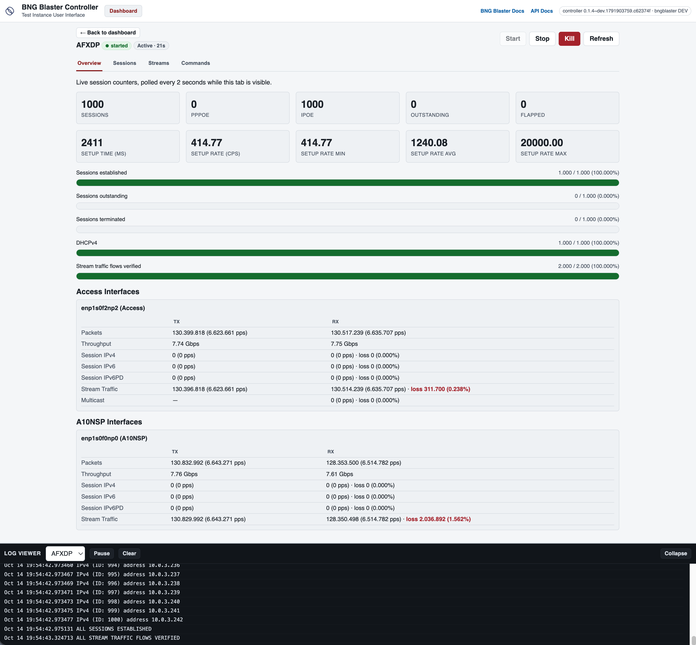

.. _controller:

Controller and Web UI
=====================

The BNG Blaster controller allows users to create, start, stop and observe multiple
test instances with ease, either programmatically through a REST API or interactively
through a :ref:`web UI <controller-web-ui>` in the browser.

By exposing the BNG Blaster :ref:`JSON RPC API <api>` as a REST API, the controller enables 
users to perform various operations programmatically. This includes initiating test instances, 
configuring test parameters, monitoring test progress, and terminating test executions. 
The REST API provides a standardized and intuitive way to control the BNG Blaster, making it 
accessible to automation scripts, external applications, or custom integrations.

Furthermore, the REST API offers endpoints to upload files like configurations and to download
logs and reports. These endpoints enable users to retrieve detailed information about the test
execution, such as test results, performance metrics, and any encountered errors or issues.

The web UI is built on top of the same REST API and provides a dashboard of all
test instances. It allows to create, start and stop test instances, watch live statistics, run
commands, follow the log and download logs, reports and captures without any additional tools,
which makes it convenient for manual and exploratory testing.

https://github.com/rtbrick/bngblaster-controller

.. image:: images/controller.png
    :alt: BNG Blaster Controller

Installation
------------

The BNG Blaster controller should run on any modern Linux distribution.
The current version of the controller requires BNG Blaster 1.0.0 or newer.

Download and install Debian package: https://github.com/rtbrick/bngblaster-controller/releases

.. code-block:: none

    $ wget https://github.com/rtbrick/bngblaster-controller/releases/download/<version>/bngblaster-controller_<version>_amd64.deb
    $ sudo dpkg -i bngblaster-controller_<version>_amd64.deb

The corresponding service will be started automatically. 

.. code-block:: none

    $ systemctl status rtbrick-bngblasterctrl.service
    ● rtbrick-bngblasterctrl.service - RtBrick BNG Blaster Controller
        Loaded: loaded (/lib/systemd/system/rtbrick-bngblasterctrl.service; enabled; vendor preset: enabled)
        Active: active (running) since Fri 2022-07-01 11:14:01 UTC; 7min ago
    Main PID: 682535 (bngblasterctrl)
        Tasks: 8 (limit: 309235)
        Memory: 2.6M
        CGroup: /system.slice/rtbrick-bngblasterctrl.service
                └─682535 /usr/local/bin/bngblasterctrl

Alternatively, the BNG Blaster :ref:`container image <install-container>`
includes the controller together with the BNG Blaster.

Configuration
-------------

The BNG Blaster controller listens on port ``8001`` per default, assumes
the BNG Blaster to be installed at ``/usr/bin/bngblaster`` and uses
``/var/bngblaster`` as directory for the test instances.

.. code-block:: none

    $ bngblasterctrl -h
    Usage of bngblasterctrl:
      -addr string
            HTTP network address (default ":8001")
      -allowed-hosts string
            comma-separated host names clients may use to reach the controller, against DNS rebinding (IP addresses and localhost are always allowed; empty allows any host)
      -color
            turn on color of color output
      -console
            turn on pretty console logging (default true)
      -d string
            config folder (default "/var/bngblaster")
      -debug
            turn on debug logging
      -e string
            bngblaster executable (default "/usr/bin/bngblaster")
      -interfaces-api
            enable the interfaces endpoint (disable with -interfaces-api=false) (default true)
      -schema string
            path to the bngblaster configuration JSON schema served on /api/v1/schema (default "/usr/share/bngblaster/bngblaster-config.json")
      -ui
            enable the embedded web UI (experimental, disable with -ui=false) (default true)
      -upload
            enable file upload (disable with -upload=false) (default true)

When installed via the Debian package, the options are configured
with the variable ``BNGBLASTERCTRL_OPTS`` in the file
``/etc/default/rtbrick-bngblasterctrl``, which is preserved across
package upgrades.

.. code-block:: none

    # /etc/default/rtbrick-bngblasterctrl
    BNGBLASTERCTRL_OPTS="-addr :8080 -d /var/bngblaster"

The service must be restarted to apply the changes.

.. code-block:: none

    $ sudo systemctl restart rtbrick-bngblasterctrl

Stopping or restarting the service (including through a package upgrade)
also stops all running test instances.

The REST API and web UI do not require authentication yet, so restrict
who can reach the port, e.g. by binding ``-addr`` to a management address,
a firewall or an SSH tunnel. The option ``-allowed-hosts`` restricts the
host names clients may use to reach the controller, which prevents DNS
rebinding attacks (e.g. ``-allowed-hosts lab01,lab01.example.com``).

.. _controller-web-ui:

Web UI
------

The controller includes an embedded web UI to create
and observe test instances without calling the REST API directly.
With the default options, it is available at ``http://<host>:8001/``.

The dashboard lists all test instances and allows to create new ones,
where the interfaces of the host are offered for selection. Each test
instance can be started, stopped and killed, and provides the following
views:

* **Overview**: live session counters, setup rates and interface statistics,
  polled every 2 seconds while the tab is visible
* **Sessions**: session details
* **Streams**: traffic stream details
* **Commands**: execute :ref:`commands <api>` on the running test instance

The log viewer at the bottom shows the log of the selected test instance.
Files like logs, reports and captures can be downloaded, and additional
files used by the configuration (e.g. MRT files) can be uploaded.

The web UI depends on two additional endpoints, which are enabled by
default as well: the interfaces endpoint (``-interfaces-api``) to list
the host interfaces when creating a test instance, and the upload endpoint
(``-upload``) to upload files into a test instance. Each of them can be
disabled individually, e.g. to run a REST-only controller.

.. code-block:: none

    BNGBLASTERCTRL_OPTS="-ui=false -interfaces-api=false -upload=false"

Disabling the interfaces or upload endpoint while keeping the web UI
enabled leaves the corresponding parts of the web UI non-functional.

API
---

OpenAPI: https://rtbrick.github.io/bngblaster-controller/

Create Test Instance
~~~~~~~~~~~~~~~~~~~~

``PUT /api/v1/instances/<instance-name>`` 

This API endpoint creates a test instance if not already created. The body of this request 
is stored as bngblaster configuration (``config.json``).

Each test instance creates a directory in ``/var/bngblaster/<instance-name>``. 
This directory contains the following files:

* ``config.json``: bngblaster configuration
* ``run.pid``: bngblaster process ID (if running)
* ``run.json``: bngblaster arguments
* ``run.log``: bngblaster log file (if enabled)
* ``run_report.json``: bngblaster report (if enabled)
* ``run.pcap``: bngblaster traffic capture (if enabled)
* ``run.sock``: bngblaster control socket
* ``run.stderr``: bngblaster standard error
* ``run.stdout``: bngblaster standard output 

Example:

.. code-block:: none

    curl --location --request PUT 'http://10.10.10.10:8001/api/v1/instances/quickstart_pppoe' \
    --header 'Content-Type: application/json' \
    --data-raw '{
        "interfaces": {
            "a10nsp": [
                {
                    "__comment__": "PPPoE Server",
                    "interface": "veth1.1"
                }
            ],
            "access": [
                {
                    "__comment__": "PPPoE Client",
                    "interface": "veth1.2",
                    "type": "pppoe",
                    "outer-vlan-min": 1,
                    "outer-vlan-max": 4000,
                    "inner-vlan": 7
                }
            ]
        }
    }'

Upload Files
~~~~~~~~~~~~

``POST /api/v1/instances/<instance-name>/_upload``

This API endpoint uploads files into the test instance directory
(up to 4 GB per file), for example MRT or BGP RAW update files
referenced in the configuration. Relative file names in the configuration
are resolved against the test instance directory. The files managed by
the controller (e.g. ``run.log``) cannot be uploaded. This endpoint can be
disabled with the option ``-upload=false``.

Example:

.. code-block:: none

    curl --location --request POST 'http://10.10.10.10:8001/api/v1/instances/quickstart_pppoe/_upload' \
    --form 'file=@isis.mrt'

Start Test
~~~~~~~~~~~

``POST /api/v1/instances/<instance-name>/_start``

The start API endpoint will start the bngblaster with the argument options
defined in the body.

.. code-block:: json

    {
        "logging": true,
        "logging_flags": [
            "debug",
            "ip"
        ],
        "report": true,
        "session_count": 1000
    }

All supported argument options are explained in the OpenAPI schema.

Example:

.. code-block:: none

    curl --location --request POST 'http://10.10.10.10:8001/api/v1/instances/quickstart_pppoe/_start' \
    --header 'Content-Type: application/json' \
    --data-raw '{
        "logging": true,
        "logging_flags": [
            "debug",
            "pppoe",
            "ip"
        ],
        "report": true,
        "session_count": 2
    }'

Status
~~~~~~

``GET /api/v1/instances/<instance-name>``

The status API endpoint returns the status of the test which can be either 
``started`` or ``stopped``.

Command 
~~~~~~~

``POST /api/v1/instances/<instance-name>/_command``

The JSON body of this API call will be passed to the bngblaster instance 
control socket (``/var/bngblaster/<instance-name>/run.sock``). The result will 
be passed back to the client.

Example:

.. code-block:: none

    curl --location --request POST 'http://10.10.10.10:8001/api/v1/instances/quickstart_pppoe/_command' \
    --header 'Content-Type: application/json' \
    --data-raw '{
        "command": "session-info",
        "arguments": {
            "session-id": 1
        }
    }'

.. code-block:: json

    {
        "status": "ok",
        "code": 200,
        "session-info": {
            "type": "pppoe",
            "session-id": 1,
            "session-state": "Established",
            "...": "..."
        }
    }

The result code is passed as HTTP response status code.

.. code-block:: json

    {
        "status": "warning",
        "code": 404, 
        "message": "session not found"
    }

Stop Test 
~~~~~~~~~

``POST /api/v1/instances/<instance-name>/_stop``

The stop API endpoint will send the SIGINT signal to the corresponding 
BNG blaster instance (``kill -INT <pid>``).

Delete Test Instance
~~~~~~~~~~~~~~~~~~~~

``DELETE /api/v1/instances/<instance-name>``

This API endpoint deletes the test instance directory. The corresponding
test run is forcefully terminated (``kill -9 <pid>``) if running. 

Reports 
~~~~~~~

The BNG Blaster can generate detailed :ref:`reports <reports>`
at the end of the test execution. Those reports must be enabled
during the start with the argument option ``report``. This detailed
report can be further enhanced using ``report_flags`` to include 
detailed per-session and stream results. Consider that the resulting 
report may be large if ``streams`` flag is enabled in combination with 
a huge amount of streams (around 500MB report file for one million streams). 

``POST /api/v1/instances/<instance-name>/_start``

 .. code-block:: json

     {
        "report": true,
        "report_flags": [
            "sessions",
            "streams"
        ]
     }

The final report can be retrieved with the following request 
after the test has finally stopped.

``GET /api/v1/instances/<instance-name>/run_report.json`` 

After requesting the test to stop, it can take some time until the test 
has gracefully stopped. This can be verified using the status command.
As soon as the status becomes stopped, the report file should be available. 

Logs
~~~~

The BNG Blaster supports extensive :ref:`logging <logging>`
during the test execution. This log file must be enabled
during the start with the argument option ``logging``. The optional
argument ``logging_flags`` allows for enabling log categories.

``POST /api/v1/instances/<instance-name>/_start``

 .. code-block:: json

     {
        "logging": true,
        "logging_flags": [
            "bgp",
            "isis",
            "ip"
        ]
     }

Please check :ref:`logging <logging>` section for detailed list
of all logging flags.

The final log file can be retrieved with the following request 
after the test has finally stopped.

``GET /api/v1/instances/<instance-name>/run.log``

It is also possible to retrieve the standard output and error
for troubleshooting purposes. 

``GET /api/v1/instances/<instance-name>/run.stderr`` 
``GET /api/v1/instances/<instance-name>/run.stdout`` 

PCAP
~~~~

The BNG Blaster supports to :ref:`capture <capture>` all traffic 
sent and received by the BNG Blaster which must be enabled during 
the start with the argument option ``pcap_capture``.

``POST /api/v1/instances/<instance-name>/_start``

 .. code-block:: json

     {
        "pcap_capture": true
     }

The final capture file can be retrieved with the following request 
after the test has finally stopped.

``GET /api/v1/instances/<instance-name>/run.pcap``

Metrics
~~~~~~~

``GET /metrics``

This endpoint returns metrics for all instances in Prometheus text format. 

.. code-block:: none

    # HELP instances_running The number of running instances
    # TYPE instances_running gauge
    instances_running{hostname="blaster"} 0
    # HELP instances_total The total number of instances
    # TYPE instances_total gauge
    instances_total{hostname="blaster"} 4

The metric ``instances_total`` counts the number of test instance directories 
present and ``instances_running`` shows how many of them are running. 

Every metric is labeled with the hostname where the controller is running.

Per default, there are no metrics per instance. This has to be explicitly 
enabled during instance start (``/api/v1/instances/<instance-name>/_start``) 
using the new  ``metric_flags`` option.

.. code-block:: json

    {
        "logging": true,
        "logging_flags": [
            "error",
            "ip"
        ],
        "metric_flags": [
            "session_counters",
            "interfaces"
        ]
    }

Currently, the following metrics are supported:

* ``session_counters`` session statistics
* ``interfaces`` interface/link counters
* ``access_interfaces`` access interface function counters
* ``network_interfaces`` network interface function counters
* ``a10nsp_interfaces`` a10nsp interface function counters
* ``streams`` stream counters

The ``streams`` metric generates statistics for every stream and direction.
Therefore the ``streams`` metric should not be used with massive streams 
(e.g. > 10000 streams) but there is no limit enforced.

.. code-block:: none

    # HELP sessions The total number of sessions
    # TYPE sessions counter
    sessions{hostname="blaster",instance_name="test"} 10
    # HELP sessions_established The number of sessions in the state established
    # TYPE sessions_established gauge
    sessions_established{hostname="blaster",instance_name="test"} 10
    ...

Instance metrics are labeled with the instance name. All interface-specific metrics
are also labeled with the corresponding interface name and type. 

.. code-block:: none

    # HELP interfaces_rx_packets Interface RX packets
    # TYPE interfaces_rx_packets counter
    interfaces_rx_packets{hostname="rbfs",instance_name="test",interface_name="eth1",interface_type="Interface"} 163
    interfaces_rx_packets{hostname="rbfs",instance_name="test",interface_name="eth11",interface_type="Network"} 155
    interfaces_rx_packets{hostname="rbfs",instance_name="test",interface_name="eth12",interface_type="Interface"} 158
    interfaces_rx_packets{hostname="rbfs",instance_name="test",interface_name="eth12",interface_type="Access"} 150
    ...