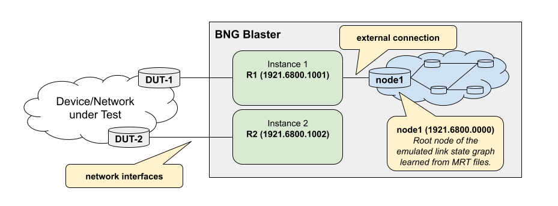
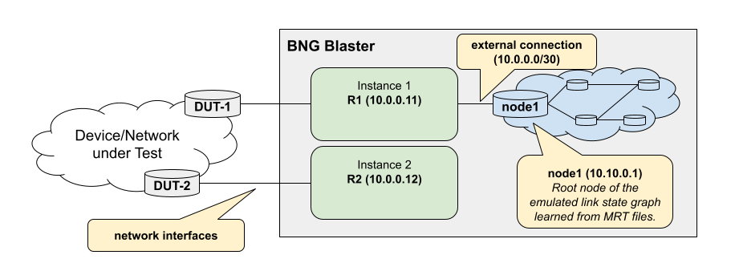

.. _lspgen:

LSPGEN
------

The BNG Blaster includes a tool called ``lspgen`` which is able to generate 
ISIS and OSPF topologies with the corresponding link state packets for export 
as MRT and PCAP files. Initially, ``lspgen`` was developed exclusively for ISIS, 
hence its name. However, with the introduction of OSPF support in BNG Blaster, 
``lspgen`` has been enhanced to accommodate OSPF topologies as well.

The default protocol is ISIS which can be changed using the argument
``-P ospf2`` or ``-P ospf3``. The arguments are processed in the given order
and the area (``-a``), connector (``-C``), sequence number (``-q``) and level
(``-V``) depend on the protocol, so ``-P`` must be set before those arguments.

.. code-block:: none

    $ lspgen --help

          ____   __   ____         _        __            ,/
         / __ \ / /_ / __ ) _____ (_)_____ / /__        ,'/
        / /_/ // __// __  |/ ___// // ___// //_/      ,' /
       / _, _// /_ / /_/ // /   / // /__ / ,<       ,'  /_____,
      /_/ |_| \__//_____//_/   /_/ \___//_/|_|    .'____    ,'
          __   _____ ____  ______                      /  ,'
         / /  / ___// __ \/ ____/__  ____             / ,'
        / /   \__ \/ /_/ / / __/ _ \/ __ \           /,'
       / /______/ / ____/ /_/ /  __/ / / /          /
      /_____/____/_/    \____/\___/_/ /_/
    
    Usage: lspgen [OPTIONS]

      -v --version
      -a --area <args>
      -P --protocol isis|ospf2|ospf3
      -K --authentication-key <args>
      -T --authentication-type none|simple|md5
      -r --read-config-file <filename>
      -w --write-config-file <filename>
      -C --connector <args>
      -S --control-socket <args>
      -I --control-instance <args>
      -l --ipv4-link-prefix <ip-prefix>
      -L --ipv6-link-prefix <ip-prefix>
      -n --ipv4-node-prefix <ip-prefix>
      -N --ipv6-node-prefix <ip-prefix>
      -x --ipv4-external-prefix <ip-prefix>
      -X --ipv6-external-prefix <ip-prefix>
      -u --link-multiplier <args>
      -M --lsp-lifetime <args>
      -z --no-ipv4
      -Z --no-ipv6
      -y --no-sr
      -A --sr-algo <algo,...>
      -F --flex-algo <algo:igp|min-delay|te[:priority],...>
      -D --link-delay <min>[:<max>]
      -E --te-metric <min>[:<max>]
      -B --node-msd <args>
      -O --elc
      -e --external-count <args>
      -g --graphviz-file <filename>
      -h --help
      -m --mrt-file <filename>
      -c --node-count <args>
      -p --pcap-file <filename>
      -G --purge
      -f --stream-file <filename>
      -s --seed <args>
      -q --sequence <args>
      -Q --quit-loop
      -V --level <args>
      -t --log normal|debug|lsp|lsdb|packet|ctrl|error

You can generate random topologies or define a topology manually 
using configuration files.

The following defaults are used if not changed by the corresponding arguments.

+-------------------------------+----------------------------------------------+
| Argument                      | Default                                      |
+===============================+==============================================+
| ``-c --node-count``           | 10                                           |
+-------------------------------+----------------------------------------------+
| ``-a --area``                 | ISIS 49.0001/24, OSPF 0.0.0.0                |
+-------------------------------+----------------------------------------------+
| ``-V --level``                | 1 (ISIS only)                                |
+-------------------------------+----------------------------------------------+
| ``-n --ipv4-node-prefix``     | 192.168.0.0/32                               |
+-------------------------------+----------------------------------------------+
| ``-l --ipv4-link-prefix``     | 172.16.0.0/31                                |
+-------------------------------+----------------------------------------------+
| ``-x --ipv4-external-prefix`` | 10.0.0.0/28                                  |
+-------------------------------+----------------------------------------------+
| ``-N --ipv6-node-prefix``     | fc00::c0a8:0/128                             |
+-------------------------------+----------------------------------------------+
| ``-L --ipv6-link-prefix``     | fc00::ac10:0/127                             |
+-------------------------------+----------------------------------------------+
| ``-X --ipv6-external-prefix`` | fc00::a00:0/124                              |
+-------------------------------+----------------------------------------------+
| ``-e --external-count``       | 0                                            |
+-------------------------------+----------------------------------------------+
| ``-u --link-multiplier``      | 1 (parallel links, maximum 150)              |
+-------------------------------+----------------------------------------------+
| ``-M --lsp-lifetime``         | ISIS 65535, OSPF 3600 (minimum 120 seconds)  |
+-------------------------------+----------------------------------------------+
| ``-q --sequence``             | ISIS 0x1, OSPF 0x80000001                    |
+-------------------------------+----------------------------------------------+

The prefixes should be set with prefix length, as a prefix without
length is interpreted as /24 for IPv4 and /64 for IPv6. OSPFv2 topologies
are IPv4 only and OSPFv3 topologies are IPv6 only. ISIS topologies
contain both address families unless disabled with ``-z`` (no IPv4)
or ``-Z`` (no IPv6).

Connector
^^^^^^^^^

The connector (``-C --connector <args>``) represents the link between the generated
topology and the attached BNG Blaster instance. 

For ISIS topologies, the connector must be set to the ``system-id`` of the ISIS
instance to which this topology is attached. In the BNG Blaster configuration, 
the ``system-id`` of the root node from the generated toplogy must be referenced. 

.. code-block:: none

    $ lspgen -a 49.0001/24 -K secret123 -T md5 -C 1921.6800.1001 -m isis.mrt
    ...
    Sep 04 10:50:55.780109 Generating a graph of 10 nodes and 20 links
    Sep 04 10:50:55.780127  Root node 1921.6800.0000.00 (node1)
    ...

.. code-block:: json

    {
        "isis": [
            {
                "instance-id": 1,
                "area": [
                    "49.0001/24"
                ],
                "system-id": "1921.6800.1001",
                "router-id": "192.168.1.1",
                "hostname": "R1",
                "level1-auth-key": "secret123",
                "level1-auth-type": "md5",
                "external": {
                    "mrt-file": "isis.mrt",
                    "connections": [
                        {
                            "system-id": "1921.6800.0000.00"
                        }
                    ]
                }
            }
        ]
    }

This is similar for OSPFv2 but here the connector is constructed based on remote router-id 
and local link IPv4 address (``remote-router-id:local-ipv4-address``). 

.. code-block:: none

    $ lspgen -P ospf2 -m ospf.mrt -n 10.10.0.1/32 --connector "10.0.0.11:10.0.0.2" -p lspgen.pcap
    ...
    Sep 04 11:02:59.242810 Generating a graph of 10 nodes and 20 links
    Sep 04 11:02:59.242827  Root node 10.10.0.1 (node1)
    ...

.. code-block:: json

    {
        "ospf": [
            {
                "instance-id": 1,
                "version": 2,
                "router-id": "10.0.0.11",
                "hostname": "R1",
                "external": {
                    "mrt-file": "ospf.mrt",
                    "connections": [
                        {
                            "router-id": "10.10.0.1",
                            "local-ipv4-address": "10.0.0.1"
                        }
                    ]
                }
            }
        ]
    }

For OSPFv3, the second part of the connector is the interface ID of the
root node towards the BNG Blaster (``remote-router-id:local-interface-id``),
for example ``10.0.0.11:0.0.0.1``, which corresponds to the
``neighbor-interface-id`` of the BNG Blaster connection.

Random Topologies
^^^^^^^^^^^^^^^^^

The following example generates a random topology with 1000 nodes. 

.. code-block:: none

    lspgen -m isis.mrt -c 1000 -K <secret> -T md5

The arguments ``-K`` and ``-T`` add a valid authentication TLV
to the generated LSPs in the MRT file. 

Those topologies could be even exported as configuration file 
with the argument ``-w`` and later imported with the argument ``-r``.
This allows the generation of a large random topology that can be modified
manually. Only one of both arguments is used, the last one wins.

Topologies with more than 1000 nodes are generated as multiple random
subgraphs of up to 1000 nodes, each connected to the previous one by
two links with metric 99.

Segment Routing
^^^^^^^^^^^^^^^

Randomly generated topologies advertise an IPv4 and IPv6 node SID
(Prefix-SID) per node for the SR algorithm 0 (SPF), which can be
disabled with the argument ``-y``.

The argument ``-A`` generates node SIDs for multiple SR algorithms
in ISIS topologies. Supported are the algorithms 0 (SPF), 1 (strict SPF)
and 128 to 255 (Flex-Algo) with up to 4 algorithms per topology. The
algorithms are also advertised in the SR-Algorithm sub-TLV of the router
capability. The SRGB range is automatically increased to hold the node SIDs
of all algorithms, starting with the IPv4 node SIDs of the first algorithm,
followed by those of the next algorithm. The IPv6 node SIDs follow the same
layout starting at half of the SRGB range.

.. code-block:: none

    lspgen -m isis.mrt -c 100 -A 0,1,128

The argument ``-F`` adds Flex-Algo definitions (FAD, RFC 9350) in the
format ``<algo>:<metric-type>[:<priority>]`` with the metric types
``igp`` (default), ``min-delay`` and ``te`` and the default priority 128.
The definitions are advertised by the first two nodes of the topology,
each in a dedicated router capability TLV. All Flex-Algos are added to the
SR algorithms, so node SIDs are generated for each of them. Without the
argument ``-A``, the SR algorithms are algorithm 0 and the Flex-Algos.

.. code-block:: none

    lspgen -m isis.mrt -c 100 -F 128:igp,129:min-delay:200

The metric types ``min-delay`` and ``te`` use the application-specific
link attributes (ASLA, RFC 8919) of the links with the Flex-Algo application
bit (X). Those are added to all links of ISIS topologies if Flex-Algo
definitions, link delays (``-D``) or TE metrics (``-E``) are configured.
The link delay in microseconds and the TE metric are randomly selected
per link from the range ``<min>:<max>``, with the same value for both
directions of a link. The values are derived from the seed (``-s``),
so the topology is reproducible. Without those arguments, the link
delay and TE metric are equal to the IGP metric.

.. code-block:: none

    lspgen -m isis.mrt -c 100 -F 128:igp,129:min-delay,130:te -D 10:1000 -E 100:200

The argument ``-B`` adds the node maximum SID depth (MSD, RFC 8491)
of type BMI-MSD with the given value (1 - 255) to all nodes of ISIS
topologies. The argument ``-O`` sets the E-flag of the prefix attribute
flags, which signals the entropy label capability (ELC, RFC 9088) for
the node prefixes.

.. code-block:: none

    lspgen -m isis.mrt -c 100 -B 10 -O

In configuration files, multiple Prefix-SIDs are defined per prefix
with ``segment_ids``. The ``index`` is mandatory, the ``algo`` defaults
to 0 and the optional ``flags`` are ``no-php``, ``explicit-null``,
``value`` and ``local``. With the flag ``value``, the index is
encoded as 20-bit label. The attribute ``segment_id`` is a short form
for a single Prefix-SID with algorithm 0. Up to 4 Prefix-SIDs are
supported per prefix, and only the first one is used for OSPF.

.. code-block:: json

    {
        "ipv4_prefix": "10.0.0.1/32",
        "metric": 0,
        "node_flag": true,
        "segment_ids": [
            {"index": 1, "algo": 0},
            {"index": 1001, "algo": 1},
            {"index": 2001, "algo": 128, "flags": ["no-php"]}
        ]
    }

The SR algorithms of the router capability are defined with
``sr_algo_list`` (e.g. ``"sr_algo_list": [0, 1, 128]``).

The node MSD is defined in the ``capability_list`` and the link MSD
per neighbor with ``msd``, a list of up to two entries with ``type``
(e.g. 1 for BMI-MSD) and ``value``. The E-flag (ELC) is set per prefix
with ``"elc_flag": true``.

.. code-block:: json

    {
        "capability_list": [
            {
                "router_id": "10.0.0.1",
                "srgb_base": 100000,
                "srgb_range": 36000,
                "msd": [{"type": 1, "value": 10}]
            }
        ]
    }

Flex-Algo prefix metrics (FAPM) are added per prefix with
``flex_algo_metrics``, for example for prefixes advertised between levels.

.. code-block:: json

    {
        "ipv4_prefix": "10.1.0.0/24",
        "metric": 10,
        "flex_algo_metrics": [
            {"algo": 128, "metric": 20}
        ]
    }

The application-specific link attributes are defined per neighbor
with ``te_metric``, ``min_delay`` and ``max_delay`` in microseconds
and the 32 bit ``admin_group``.

.. code-block:: json

    {
        "remote_node_id": "1337.0000.0002.00",
        "metric": 10,
        "te_metric": 100,
        "min_delay": 1000,
        "max_delay": 1200,
        "admin_group": 1
    }

Flex-Algo definitions are defined per node with ``flex_algo_list``.
The ``algo`` (128 - 255) is mandatory. The ``metric_type`` is ``igp``
(default), ``min-delay`` or ``te``, the ``priority`` defaults to 128,
``m_flag`` requires the Flex-Algo prefix metric for inter-area prefixes
and the 32 bit admin group masks ``exclude_any``, ``include_any`` and
``include_all`` are only advertised if not zero. The ``router_id`` of
the router capability TLV should be set to the router ID of the node.

.. code-block:: json

    {
        "flex_algo_list": [
            {"router_id": "10.0.0.1", "algo": 128, "metric_type": "igp"},
            {"router_id": "10.0.0.1", "algo": 129, "metric_type": "min-delay",
             "priority": 200, "m_flag": true, "exclude_any": 1}
        ]
    }

Output Files
^^^^^^^^^^^^

The generated link state packets are written to the following files.

* ``-m --mrt-file``: MRT file (RFC 6396) to be loaded by the BNG Blaster
  with the ``mrt-file`` of the ``external`` ISIS or OSPF configuration.
* ``-p --pcap-file``: PCAP file with all link state packets.
* ``-w --write-config-file``: configuration file of the topology,
  see below.
* ``-f --stream-file``: JSON file with the list of ``destinations``,
  which are all node, link and external prefixes of the topology. This
  list can be used to create the corresponding BNG Blaster traffic streams.
* ``-g --graphviz-file``: graphviz file ``<filename>.dot``, which is
  converted into ``<filename>.svg`` if the graphviz command ``dot`` is installed.

The sequence numbers of all nodes are stored in a sequence cache file
in the current working directory (``isis-level<level>-sequence-cache.json``
or ``ospf-area<area>-sequence-cache.json``). The next run of ``lspgen`` for
the same level or area increments those sequence numbers by one, so that the
updated link state packets replace the previous ones in the network.
With the argument ``-G``, all link state packets are generated as purges.

Control Socket
^^^^^^^^^^^^^^

Instead of loading an MRT file, ``lspgen`` can inject the generated link
state packets directly into a running BNG Blaster instance using its
control socket (``-S --control-socket``) with the ``isis-lsp-update``
or ``ospf-pdu-update`` :ref:`command <api>`. The ISIS or OSPF instance
of the BNG Blaster is selected with ``-I --control-instance`` (default 0).

.. code-block:: none

    lspgen -C 1921.6800.1001 -S run.sock -I 1

In this mode, ``lspgen`` keeps running and refreshes the link state
packets 300 seconds before the lifetime expires until it is stopped
with Ctrl-C. The argument ``-Q --quit-loop`` stops ``lspgen`` after all
packets have been sent once.

Topology from Configuration File
^^^^^^^^^^^^^^^^^^^^^^^^^^^^^^^^

In addition to randomly generated topologies, it is also possible to 
create them specifically using configuration. The following example 
shows the configuration for a topology with three nodes.

.. code-block:: json

    {
        "instance": "default",
        "protocol": "isis",
        "level1": [
            {
                "node_id": "1337.0000.0001",
                "hostname": "R1",
                "area_list": [
                    "49.1337/24"
                ],
                "protocol_list": [
                    "ipv4"
                ],
                "ipv4_address_list": [
                    "10.13.37.1"
                ],
                "ipv4_prefix_list": [
                    {
                        "ipv4_prefix": "10.13.37.1/32",
                        "metric": 0,
                        "segment_id": 30005,
                        "node_flag": true
                    },
                    {
                        "ipv4_prefix": "10.0.1.0/24",
                        "metric": 1000
                    },
                    {
                        "ipv4_prefix": "10.0.2.0/24",
                        "metric": 1000
                    }
                ],
                "capability_list": [
                    {
                        "router_id": "10.13.37.1",
                        "mpls_ipv4_flag": true,
                        "mpls_ipv6_flag": false,
                        "srgb_base": 100000,
                        "srgb_range": 36000
                    }
                ],
                "neighbor_list": [
                    {
                        "remote_node_id": "1337.0000.0000.00",
                        "metric": 10
                    },
                    {
                        "remote_node_id": "1337.0000.0002.00",
                        "metric": 10
                    },
                    {
                        "remote_node_id": "1337.0000.0003.00",
                        "metric": 10
                    }
                ]
            },
            {
                "node_id": "1337.0000.0002",
                "hostname": "R2",
                "area_list": [
                    "49.1337/24"
                ],
                "protocol_list": [
                    "ipv4"
                ],
                "ipv4_address_list": [
                    "10.13.37.2"
                ],
                "ipv4_prefix_list": [
                    {
                        "ipv4_prefix": "10.13.37.2/32",
                        "metric": 0,
                        "segment_id": 30003,
                        "node_flag": true
                    }
                ],
                "capability_list": [
                    {
                        "router_id": "10.13.37.2",
                        "mpls_ipv4_flag": true,
                        "mpls_ipv6_flag": false,
                        "srgb_base": 100000,
                        "srgb_range": 36000
                    }
                ],
                "neighbor_list": [
                    {
                        "remote_node_id": "1337.0000.0001.00",
                        "metric": 10
                    }
                ]
            },
            {
                "node_id": "1337.0000.0003",
                "hostname": "R3",
                "area_list": [
                    "49.1337/24"
                ],
                "protocol_list": [
                    "ipv4"
                ],
                "ipv4_address_list": [
                    "10.13.37.3"
                ],
                "ipv4_prefix_list": [
                    {
                        "ipv4_prefix": "10.13.37.3/32",
                        "metric": 0,
                        "segment_id": 30004,
                        "node_flag": true
                    }
                ],
                "capability_list": [
                    {
                        "router_id": "10.13.37.3",
                        "mpls_ipv4_flag": true,
                        "mpls_ipv6_flag": false,
                        "srgb_base": 100000,
                        "srgb_range": 36000
                    }
                ],
                "neighbor_list": [
                    {
                        "remote_node_id": "1337.0000.0001.00",
                        "metric": 10
                    }
                ]
            }
        ]
    }

For OSPF, the topology is defined in the list ``area<area>`` (e.g.
``area0.0.0.0``) instead of ``level1`` or ``level2``, and the
``protocol`` is ``ospf2`` or ``ospf3``. The ``node_id`` is the router ID.
The links are defined with the ``local_link_id`` (OSPFv2 local interface
address, OSPFv3 interface ID) and the optional ``remote_link_id``. A
prefix with ``node_flag`` and ``segment_id`` is advertised as loopback
including the Prefix-SID in the OSPFv2 Extended Prefix LSA or OSPFv3
Extended Intra-Area-Prefix LSA. Prefixes with ``external_flag``
are advertised as external LSA.

.. code-block:: json

    {
        "instance": "default",
        "protocol": "ospf2",
        "lsp_lifetime": 3600,
        "area0.0.0.0": [
            {
                "node_id": "192.168.0.0",
                "hostname": "node1",
                "is_root": true,
                "capability_list": [
                    {
                        "router_id": "192.168.0.0",
                        "srgb_base": 10000,
                        "srgb_range": 5
                    }
                ],
                "ipv4_prefix_list": [
                    {
                        "ipv4_prefix": "192.168.0.0/32",
                        "metric": 0,
                        "segment_id": 0,
                        "node_flag": true
                    },
                    {
                        "ipv4_prefix": "172.16.0.0/31",
                        "metric": 5000
                    }
                ],
                "neighbor_list": [
                    {
                        "remote_node_id": "10.0.0.11",
                        "local_link_id": "10.0.0.2",
                        "remote_link_id": "0.0.0.1",
                        "metric": 100
                    },
                    {
                        "remote_node_id": "192.168.0.1",
                        "local_link_id": "172.16.0.0",
                        "metric": 5000
                    }
                ]
            }
        ]
    }

The following further attributes are supported.

* Node: ``sequence``, ``lsp_lifetime``, ``is_root`` (root node of the
  topology), and for ISIS ``overload``, ``attach``, ``lsp_buffer_size``,
  ``ipv6_address_list`` and ``adjacency_sid_base`` (first Adjacency-SID,
  incremented per neighbor).
* Prefix: ``external_flag``, ``updown_flag``, ``tag`` and for ISIS
  ``small_metrics`` (TLV 128 and 130 instead of TLV 135), which is
  also supported per neighbor (TLV 2 instead of TLV 22).
* Router capability: ``s_flag`` and ``d_flag`` (ISIS flooding scope
  and down flag).
* Label binding (ISIS SID/Label Binding TLV): ``label_binding_list``
  with entries of ``ipv4_prefix`` or ``ipv6_prefix``, ``range``,
  ``segment_id`` and ``s_flag``.

The randomly generated topologies can be also written to a file
to have an example or starting point for the desired topologies. 

.. code-block:: none

    lspgen -P isis -w isis.json 
    lspgen -P ospf2 -w ospf2.json 
    lspgen -P ospf3 -w ospf3.json 
